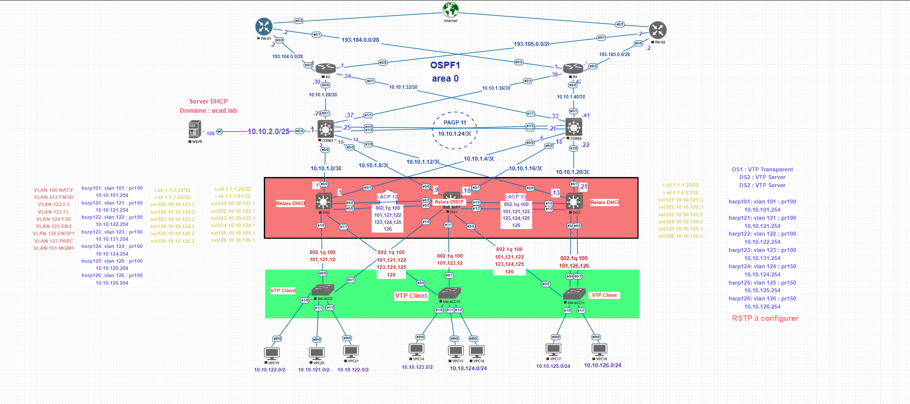

# 🌐 Ingénierie de Trafic & Haute Disponibilité sur Architecture Réseau 3-Tiers


Conception, implémentation et analyse d'ingénierie de trafic d'une architecture réseau d'entreprise hiérarchique à **trois couches (Cœur/Bordure, Distribution, Accès)** entièrement redondante. Ce laboratoire met en œuvre le partage de charge de niveau 2 et de niveau 3, l'agrégation de liens multi-protocoles, le routage dynamique maillé, un double accès WAN avec translation d'adresses (PAT) ainsi qu'un service DHCP centralisé.

---

## 📑 Table des Matières

1. [Architecture & Topologie](#-architecture--topologie)
2. [Ingénierie de Trafic & Protocoles Déployés](#-ingénierie-de-trafic--protocoles-déployés)
3. [Plan d'Adressage IP Complet](#-plan-dadressage-ip-complet)
4. [Matrices de Trafic (Flux Nominaux & Secours)](#-matrices-de-trafic-flux-nominaux--secours)
5. [Structure du Dépôt](#-structure-du-dépôt)
6. [Déploiement & Vérifications](#-déploiement--vérifications)
7. [Auteur & Encadrement](#-auteur--encadrement)

---

## 📐 Architecture & Topologie



L'infrastructure s'articule autour de **12 équipements réseau Cisco** et d'un **serveur d'infrastructure Windows Server**, répartis selon le modèle hiérarchique Cisco :

* **Couche Bordure & WAN :** Deux routeurs fournisseurs d'accès (`FAI-01`, `FAI-02`) connectés en maillage complet (*Full-Mesh*) aux deux routeurs de bordure (`R3`, `R4`).
* **Couche Cœur (*Core*) :** Deux commutateurs multicouches (`CORE3`, `CORE4`) assurant la commutation rapide de paquets, reliés entre eux par un agrégat **PAgP** et hébergeant la ferme de serveurs (`WSVR`).
* **Couche Distribution :** Trois commutateurs multicouches (`DIS1`, `DIS2`, `DIS3`) interconnectés en L2 via **LACP**, assurant le routage inter-VLAN, le relais DHCP et la redondance des passerelles.
* **Couche Accès :** Trois commutateurs L2 (`SW-ACC9`, `SW-ACC10`, `SW-ACC11`) raccordant les postes clients (`VPC14` à `VPC21`) répartis sur 6 VLANs métiers.

---

## 🛠️ Ingénierie de Trafic & Protocoles Déployés

### 1. Ingénierie de Flux Niveau 2 (Commutation)
* **MSTP (Multiple Spanning Tree Protocol — IEEE 802.1s) :**
  * Domaine : `CIN4_TPE_02` | Révision : `1`.
  * Répartition déterministe des arbres couvrants sur la couche distribution :
    * **Instance MST 1 (Root : `DIS2` — prio 4096) :** VLANs `100` (NATIF), `101` (MGMT), `121` (FMSB), `122` (FS), `127` (PARC).
    * **Instance MST 2 (Root : `DIS1` — prio 4096) :** VLANs `123` (FL), `124` (FSE).
    * **Instance MST 3 (Root : `DIS3` — prio 4096) :** VLANs `125` (ENS), `126` (ENSPY).
* **EtherChannel (Agrégation de liens) :**
  * **PAgP (`Port-channel 11`, mode `desirable`) :** Lien L3 (`10.10.1.24/30`) entre `CORE3` et `CORE4`.
  * **LACP (`Port-channel 12`, `13`, `14`, mode `active`) :** Trunks 802.1Q agrégés entre `DIS1`–`DIS2`, `DIS1`–`DIS3` et `DIS3`–`SW-ACC11`.
* **VTPv2 (Domaine `ACADENSPY`) :** Propagation automatique de la base VLAN depuis `DIS2` et `DIS3` (*VTP Server*) vers `SW-ACC9`, `SW-ACC10` et `SW-ACC11` (*VTP Client*), avec `DIS1` configuré en mode *Transparent*.
* **Sécurité des ports d'accès :** Activation systématique de `PortFast`, `BPDU Guard`, `switchport nonegotiate` et `Port-Security` (`maximum 2`, `mac-address sticky`, `violation shutdown`).

### 2. Ingénierie de Flux Niveau 3 (Routage & Redondance)
* **HSRP (Hot Standby Router Protocol) :** Partage de charge actif/passif des passerelles par défaut :
  * **`DIS2` (Active — Priorité 150, `preempt`) :** Porte le trafic sortant des VLANs **121, 122 et 123**.
  * **`DIS3` (Active — Priorité 150, `preempt`) :** Porte le trafic sortant des VLANs **124, 125 et 126**.
* **OSPFv2 (`Process 1`, `Area 0`) :**
  * Tous les liens d'interconnexion sont configurés en `ip ospf network point-to-point` afin d'éliminer l'élection DR/BDR et d'accélérer la convergence.
  * Diffusion de la route par défaut (`default-information originate`) depuis `FAI-01` et `FAI-02` avec équilibrage ECMP (*Equal-Cost Multi-Path*) dans le cœur de réseau.
  * Interface `e0/3` de `CORE3` (vers `WSVR`) configurée en `passive-interface`.

### 3. Services Réseau & Sortie Internet
* **Serveur DHCP Centralisé (`WSVR` — Windows Server 2012 R2) :**
  * Adresse IP : `10.10.2.126/25` | Domaine : `acad.lab` | DNS : `8.8.8.8`, `8.8.4.4`.
  * Héberge les 6 étendues (*Scopes*) correspondant aux VLANs `121` à `126`, sollicitées via `ip helper-address 10.10.2.126` sur l'ensemble des interfaces SVI.
* **NAT / PAT Multi-Homed :**
  * Translation dynamique avec surcharge (`overload`) sur les interfaces WAN `e0/2` de `FAI-01` et `FAI-02` permettant à l'ensemble des sous-réseaux internes (`10.10.121.0/24` – `10.10.126.0/24`) d'accéder à Internet.

---

## 📊 Plan d'Adressage IP Complet

### 1. Plan des VLANs, SVI et Groupes HSRP

| VLAN | Nom | Sous-réseau | SVI `DIS1` | SVI `DIS2` | SVI `DIS3` | Passerelle (VIP) | Rôle HSRP |
| :---: | :--- | :--- | :---: | :---: | :---: | :---: | :--- |
| **100** | `NATIF` | — | — | — | — | — | VLAN Natif 802.1Q |
| **101** | `MGMT` | `10.10.101.0/24` | — | — | — | `10.10.101.254` | Administration |
| **121** | `FMSB` | `10.10.121.0/24` | `.1` | `.2` | `.3` | `10.10.121.254` | `DIS2` Active / `DIS3` Standby |
| **122** | `FS` | `10.10.122.0/24` | `.1` | `.2` | `.3` | `10.10.122.254` | `DIS2` Active / `DIS3` Standby |
| **123** | `FL` | `10.10.123.0/24` | `.1` | `.2` | `.3` | `10.10.123.254` | `DIS2` Active / `DIS3` Standby |
| **124** | `FSE` | `10.10.124.0/24` | `.1` | `.2` | `.3` | `10.10.124.254` | `DIS3` Active / `DIS2` Standby |
| **125** | `ENS` | `10.10.125.0/24` | `.1` | `.2` | `.3` | `10.10.125.254` | `DIS3` Active / `DIS2` Standby |
| **126** | `ENSPY` | `10.10.126.0/24` | `.1` | `.2` | `.3` | `10.10.126.254` | `DIS3` Active / `DIS2` Standby |
| **127** | `PARC` | — | — | — | — | — | Réserve Parc |

### 2. Liens d'Interconnexion L3 & Loopbacks

| Équipement | Router-ID (`Lo0`) | Interfaces & Adresses IP |
| :--- | :---: | :--- |
| **FAI-01** | `1.1.1.1/32` | `e0/0`: `193.104.0.2/28` (R3) \| `e0/1`: `193.184.0.2/28` (R4) \| `e0/2`: `DHCP` (WAN) |
| **FAI-02** | `1.1.1.2/32` | `e0/0`: `193.185.0.2/28` (R4) \| `e0/1`: `193.105.0.2/28` (R3) \| `e0/2`: `DHCP` (WAN) |
| **R3** | `1.1.1.3/32` | `e0/0`: `10.10.1.30/30` (CORE3) \| `e0/1`: `10.10.1.34/30` (CORE4) \| `e0/2`: `193.104.0.1/28` \| `e0/3`: `193.105.0.1/28` |
| **R4** | `1.1.1.4/32` | `e0/0`: `10.10.1.42/30` (CORE4) \| `e0/1`: `10.10.1.38/30` (CORE3) \| `e0/2`: `193.185.0.1/28` \| `e0/3`: `193.184.0.1/28` |
| **CORE3** | `1.1.1.11/32` | `e0/0`: `10.10.1.2/30` (DIS2) \| `e0/1`: `10.10.1.29/30` (R3) \| `e0/2`: `10.10.1.10/30` (DIS1) \| `e0/3`: `10.10.2.1/25` (WSVR) \| `e1/0`: `10.10.1.14/30` (DIS3) \| `e1/1`: `10.10.1.37/30` (R4) \| `Po11`: `10.10.1.25/30` (CORE4) |
| **CORE4** | `1.1.1.12/32` | `e0/0`: `10.10.1.6/30` (DIS2) \| `e0/1`: `10.10.1.41/30` (R4) \| `e0/2`: `10.10.1.18/30` (DIS1) \| `e1/0`: `10.10.1.22/30` (DIS3) \| `e1/1`: `10.10.1.33/30` (R3) \| `Po11`: `10.10.1.26/30` (CORE3) |
| **DIS1** | `1.1.1.21/32` | `e0/0`: `10.10.1.9/30` (CORE3) \| `e0/1`: `10.10.1.17/30` (CORE4) |
| **DIS2** | `1.1.1.22/32` | `e0/0`: `10.10.1.1/30` (CORE3) \| `e0/1`: `10.10.1.5/30` (CORE4) |
| **DIS3** | `1.1.1.23/32` | `e0/0`: `10.10.1.13/30` (CORE3) \| `e0/1`: `10.10.1.21/30` (CORE4) |

---

## 🔀 Matrices de Trafic (Flux Nominaux & Secours)

L'ingénierie de trafic repose sur la séparation des chemins nominaux et des liens croisés de bascule (*failover*) :

* **Trafic Externe (Bordure $\leftrightarrow$ WAN) :**
  * **Chemins Nominaux :** `R3` $\leftrightarrow$ `FAI-01` (`193.104.0.0/28`) et `R4` $\leftrightarrow$ `FAI-02` (`193.185.0.0/28`).
  * **Liens Croisés de Secours :** `R3` $\leftrightarrow$ `FAI-02` (`193.105.0.0/28`) et `R4` $\leftrightarrow$ `FAI-01` (`193.184.0.0/28`), activés automatiquement par convergence OSPF en cas de coupure d'un lien primaire ou d'un FAI.
* **Trafic Cœur $\leftrightarrow$ Bordure :**
  * Liens directs (`10.10.1.28/30` et `10.10.1.40/30`), liens croisés (`10.10.1.32/30` et `10.10.1.36/30`) et lien d'équilibrage inter-cœur **PAgP11** (`10.10.1.24/30`).
* **Trafic Interne (Accès $\leftrightarrow$ Distribution $\leftrightarrow$ Cœur) :**
  * **Flux DHCP (`UDP 67/68`) :** Capté par les SVI de distribution puis relayé en unicast vers `WSVR` (`10.10.2.126`) via `CORE3`.
  * **Flux Utilisateurs :** Répartis entre `DIS2` et `DIS3` selon le groupe HSRP du VLAN source, puis acheminés en ECMP vers `CORE3` et `CORE4`.

---

## 📁 Structure du Dépôt

```text
├── README.md                                                                 # Documentation technique du projet
├── topologie.png                                                             # Schéma complet de l'architecture 3-Tiers
├── 02_Traffic_Engineer_3-TIER.unl                                            # Fichier de topologie EVE-NG prêt à importer
├── Rapport_BOUM_LIKAK_JULES_DAROLD_23P065_TPE_02_Ingénieurie_de_Trafic.pdf   # Rapport complet (configs, tests & matrices de trafic)
└── configs/                                                                  # Configurations Cisco IOS classées par couche
    ├── 01-Coeur-Bordure/
    │   ├── FAI-01.txt                                                        # Routeur FAI 1 (OSPF, NAT/PAT)
    │   ├── FAI-02.txt                                                        # Routeur FAI 2 (OSPF, NAT/PAT)
    │   ├── R3.txt                                                            # Routeur Bordure 1 (OSPF Area 0)
    │   ├── R4.txt                                                            # Routeur Bordure 2 (OSPF Area 0)
    │   ├── CORE3.txt                                                         # Switch L3 Cœur 1 (OSPF, PAgP 11, Passerelle WSVR)
    │   └── CORE4.txt                                                         # Switch L3 Cœur 2 (OSPF, PAgP 11)
    ├── 02-Distribution/
    │   ├── DIS1.txt                                                          # Switch L3 Distribution 1 (MST2 Root, VTP Transparent, LACP 12/13)
    │   ├── DIS2.txt                                                          # Switch L3 Distribution 2 (MST1 Root, HSRP 121-123, VTP Server)
    │   └── DIS3.txt                                                          # Switch L3 Distribution 3 (MST3 Root, HSRP 124-126, VTP Server)
    └── 03-Acces/
        ├── SW-ACC9.txt                                                       # Switch Accès 1 (MSTP, VTP Client, Port-Security)
        ├── SW-ACC10.txt                                                      # Switch Accès 2 (MSTP, VTP Client, Port-Security)
        └── SW-ACC11.txt                                                      # Switch Accès 3 (MSTP, VTP Client, LACP 14, Port-Security)
